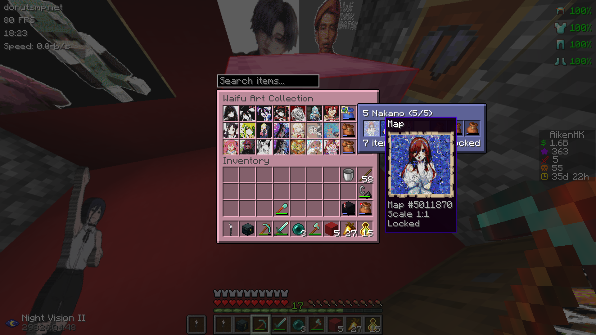
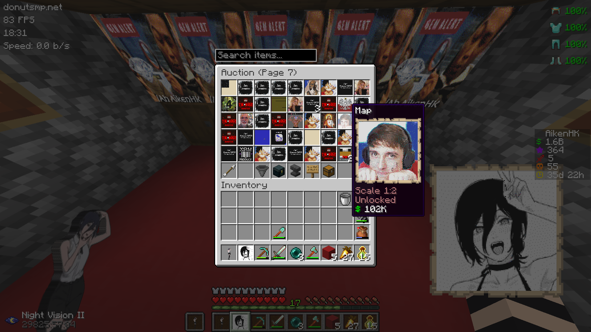
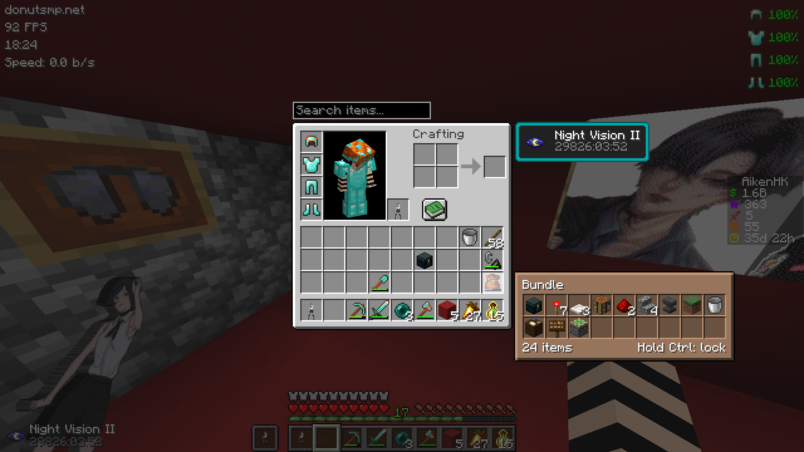
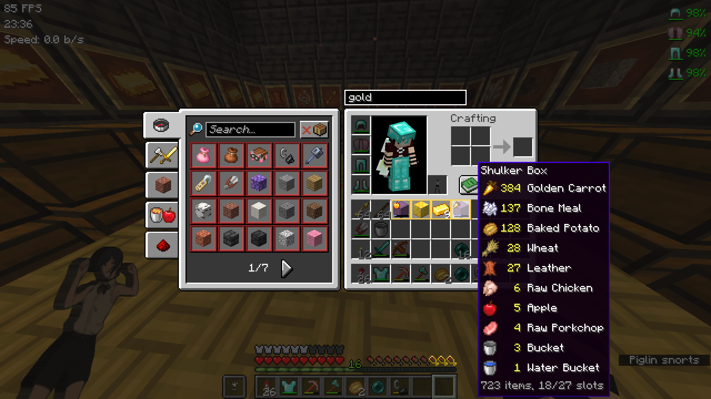
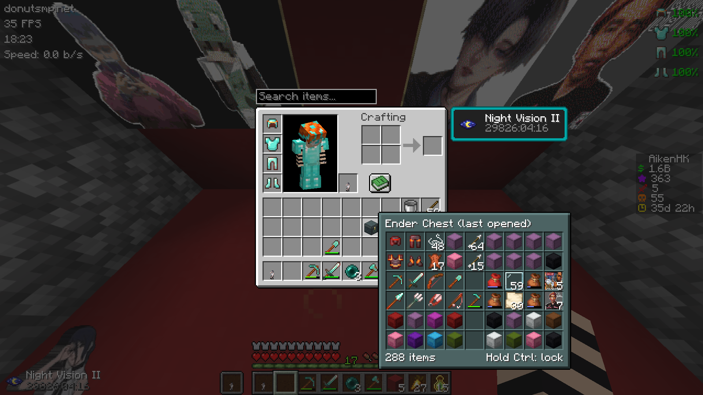
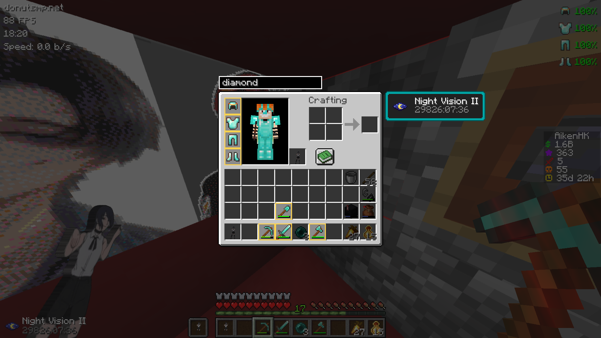

<p align="center">
  
</p>

<h1 align="center">Universal Viewer (Horizon WebAssembly Mod)</h1>

<p align="center">
  See inside <strong>shulker boxes</strong>, <strong>bundles</strong>, <strong>ender chests</strong>, and <strong>maps</strong> without opening them — running sandboxed as <code>mod.wasm</code> on Horizon (Minecraft Java 26.3, <code>api = "0.2"</code>, version <strong>0.2.2</strong>).<br>
  No native binary, native mixins, or native-code trust prompt required on the player's machine.
</p>

## Preview

<table>
  <tr>
    <td width="50%"><br><sub>Map pictures on chest slots and in the map tooltip, with ID, scale, and lock status.</sub></td>
    <td width="50%"><br><sub>Map tooltip in server menus; server lines such as prices remain visible.</sub></td>
  </tr>
  <tr>
    <td width="50%"><br><sub>Hold Shift to view shulker box or bundle contents as a vanilla-style grid.</sub></td>
    <td width="50%"><br><sub>Hold Alt to view contents as a summary list sorted by total item count.</sub></td>
  </tr>
  <tr>
    <td width="50%"><br><sub>Last-seen ender chest contents, previewed directly from an ender chest item.</sub></td>
    <td width="50%"><br><sub>Container search box: matching slots are outlined in yellow and others are dimmed.</sub></td>
  </tr>
</table>

## Credits & Attribution

- **Original creator:** [Aiken1609](https://github.com/Aiken1609)
- **Original project:** [Aiken1609/uni-viewer](https://github.com/Aiken1609/uni-viewer)
- **WASM fork and maintainer:** iuaiti
- **Fork repository:** [iuaiti/Universal-Viewer-WASM](https://github.com/iuaiti/Universal-Viewer-WASM)

This project is a WebAssembly port of the original Universal Viewer for Horizon (updated to **0.2.2**). It adapts the upstream features to Horizon's WASM sandbox and removes native-only dependencies.

## Features (WASM Edition — v0.2.2)

- **Shulker Box & Bundle Contents Grid:** Hold **Shift** (rebindable) while hovering to view the full vanilla-style slot grid tinted to the shulker or bundle's dye colour (16 dye colours + plain). Works on every server, including vanilla servers.
- **Contents List View:** Hold **Alt** (rebindable) while hovering a shulker box, bundle, or remembered ender chest — including inside locked panels — to show one row per item type with its icon and total count, sorted from highest count, plus total items and used slots.
- **Slot Marks:** Shulker boxes show a fill bar below their icon, and both shulker boxes and bundles show a small icon of their most abundant item in the top-left corner. Configurable under **Options > Mods > Universal Viewer** (both, fill bar only, top item only, or off).
- **Ender Chest Memory:** Whenever you open an ender chest (including server `/ec` menus), its contents are remembered in memory per server address or singleplayer world for the current session (nothing is written to disk). Hold **Shift** (grid) or **Alt** (list) over an ender chest item to inspect its last-seen contents.
- **Container Search Field:** A **Search items...** box above container and inventory screens matches items by name — searching up to 3 levels deep inside shulker boxes, bundles, and the remembered ender chest. Matching slots get a yellow outline while non-matching slots are dimmed (`Esc` unfocuses, closing the screen clears it, and the field can be hidden in mod options).
- **Lock Contents Panel:** Hold (or toggle) **Ctrl** (rebindable) while the contents grid is open to lock it in place and inspect individual items inside, including custom names, enchantments, lore, nested containers (with Shift/Alt), and map previews.
- **Coloured Placed Shulker Box UI:** Opening a placed shulker box tints its inventory screen and slots to match its dye colour.
- **Creative Screen Support:** Displays map previews and container slot marks on the hotbar across tabs and on the inventory tab.
- **Map Previews:** Displays map pictures directly on slot icons (inventory, chests, ender chests, hotbar, and Creative) and framed in tooltips with ID, scale (`1:1` to `1:16`), and Locked/Unlocked status. Tooltip size is configurable (`64`, `96`, or `128 px` default).

## Controls & Settings

- **Options > Controls** (under **Universal Viewer**, all rebindable):
  - **Show contents (grid):** `Left Shift` by default (either Shift works)
  - **Show contents (list):** `Left Alt` by default (either Alt works)
  - **Lock contents preview:** `Left Ctrl` by default (either Ctrl works)
- **Options > Mods > Universal Viewer:**
  - **Lock key:** Hold to lock / Press to toggle
  - **Tooltip map size:** `64 px` / `96 px` / `128 px`
  - **Shulker and bundle slot marks:** Fill bar and top item / Fill bar only / Top item only / Off
  - **Search field:** Shown / Hidden

## WebAssembly Compatibility & Limitations

The original project uses a native `vanilla_map` mixin to intercept vanilla multiplayer `MapItemData` packets.

Since Horizon WebAssembly mods do not support `[[native.mixin]]`, this mixin has been removed in the WASM port.

- The replacement uses the mod's optional server-side payload channel:
  - `universal_viewer:map_request`
  - `universal_viewer:map_data`
- A built-in standard Minecraft map colour palette (`DEFAULT_MAP_BASE_RGB`) is used to render map pictures without a native mixin.
- The manifest uses `side = "client"`, so Horizon servers without this mod still accept players using it, while singleplayer and Horizon servers with Universal Viewer installed still respond to map requests (rate-limited to 10 replies per second per player on native hosts, and checked against slots the player can see).

### Feature availability

| Feature | Singleplayer | Vanilla server | Horizon server with mod |
|---|---|---|---|
| Shulker box & bundle grid (`Shift`) | Yes | Yes | Yes |
| Contents list view (`Alt`) | Yes | Yes | Yes |
| Slot marks (fill bar & top item) | Yes | Yes | Yes |
| Ender chest memory | Yes | Yes | Yes |
| Deep container search field | Yes | Yes | Yes |
| Ctrl-lock panel | Yes | Yes | Yes |
| Coloured placed shulker UI | Yes | Yes | Yes |
| Map previews | Yes | Limited | Yes |

**Map preview limitations:**

- In singleplayer, map pictures are served locally via the mod's built-in payload handler.
- On Horizon multiplayer servers with Universal Viewer installed, the optional payload system provides map data.
- On vanilla multiplayer servers without the server-side mod, map pictures are unavailable because native packet interception mixins are not supported in WASM.
- All container previews, list view, slot marks, ender chest memory, container search, Ctrl-lock, and coloured shulker UI work normally on vanilla servers.

## Build (WebAssembly)

Pinned to Horizon Nightly SDK **`f1bb66f`** (`f1bb66f353cf67f2aa4665293fc75c8d91186fc7`).

Requires Rust (`rustup`, Rust 1.95+) and `cargo-horizon-mod` for development and building.

Install the build tool:

```bash
cargo install --locked --git https://github.com/horizon-rust/horizon cargo-horizon-mod
```

Optionally update the SDK pin in `Cargo.toml` to the latest Horizon Nightly:

```bash
cargo horizon-mod update
```

Build the WASM module and package the `.hmod`:

```bash
cargo horizon-mod build --wasm
```

The build produces:

```text
mod.wasm
target/horizon-mod/universal_viewer.hmod
```

Do not edit the `[wasm]` table in `horizon-mod.toml` manually. The build command generates it automatically.

**Note:** Developers need Rust to compile the mod (or use GitHub Actions via `.github/workflows/build-wasm.yml`). Players do not need Rust, Cargo, or a native compiler to install or run it.

## Install

1. Download `universal_viewer.hmod` from the GitHub Actions artifact or Releases (or build it with `cargo horizon-mod build --wasm`), and copy it into your game's `horizon-mods/` directory.
2. Add `mod.universal_viewer:true` to `horizon-mods.txt` (beside `options.txt`).
3. Launch Horizon.
4. Configure the mod under **Options > Mods > Universal Viewer** and **Options > Controls**.

## License

MIT. See [LICENSE](LICENSE).

This project retains attribution to the original Universal Viewer creator, Aiken1609, and its upstream repository.
